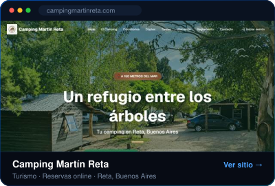
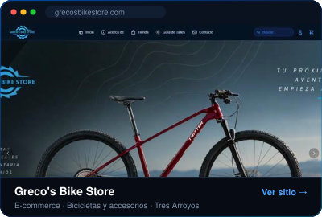

<!--
  ═══════════════════════════════════════════════════════════════════
  Perfil de GitHub — Vlobos01
  · Banner: assets/banner.svg (logo embebido en base64)
  · Guía:   INSTRUCCIONES.md
  ═══════════════════════════════════════════════════════════════════
-->

  

  
  
  

## 👋 Hola, soy **Agustín Verga Lobos**

**Analista en Sistemas** de Buenos Aires, Argentina. Me gusta convertir ideas en software que funcione: hoy trabajo con **Dart, Flutter, JavaScript y TypeScript**, y sigo profundizando en **React**.

- 🎓 Analista en Sistemas
- 💻 Desarrollo con **Dart · Flutter · JavaScript · TypeScript**
- 🌱 Profundizando en **React**
- 📍 **Buenos Aires, Argentina**
- 💬 Preguntame sobre **Flutter, Dart, JavaScript y TypeScript**

## 🛠️ Stack

<table>
  <tr>
    <td><b>Frontend</b></td>
    <td></td>
  </tr>
  <tr>
    <td><b>Mobile</b></td>
    <td></td>
  </tr>
  <tr>
    <td><b>Backend</b></td>
    <td></td>
  </tr>
  <tr>
    <td><b>Herramientas</b></td>
    <td></td>
  </tr>
</table>

## 📊 Estadísticas

  
  

  

## 🚀 Proyecto destacado

  

  Generador de presupuestos <b>100% offline</b> con React + IndexedDB: PDF profesionales, estados y cobros parciales. 
  <a href="https://nexora-pied-mu.vercel.app"><b>Ver demo en vivo →</b></a>

## 🌐 Sitios web

  Sitios reales en producción, fuera de GitHub.

  
  

  <a href="https://github.com/Vlobos01?tab=repositories">Ver repositorios →</a>

## 🐍 Contribuciones

  

## 📬 Contacto

  ¿Tenés una idea o un proyecto en mente? <a href="mailto:agusvergalobos2016@gmail.com"><b>Escribime</b></a>.

  

  

<i>Hecho con ♥ y mucho ☕</i>

